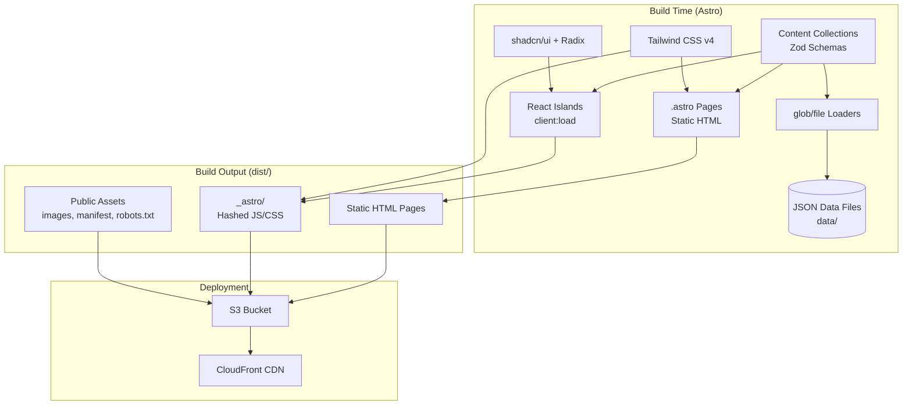
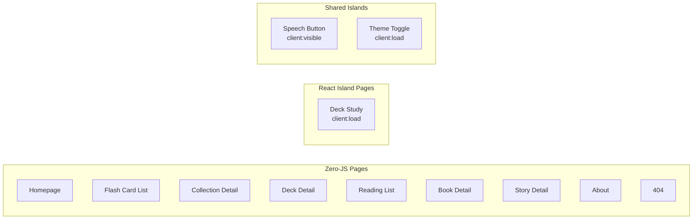
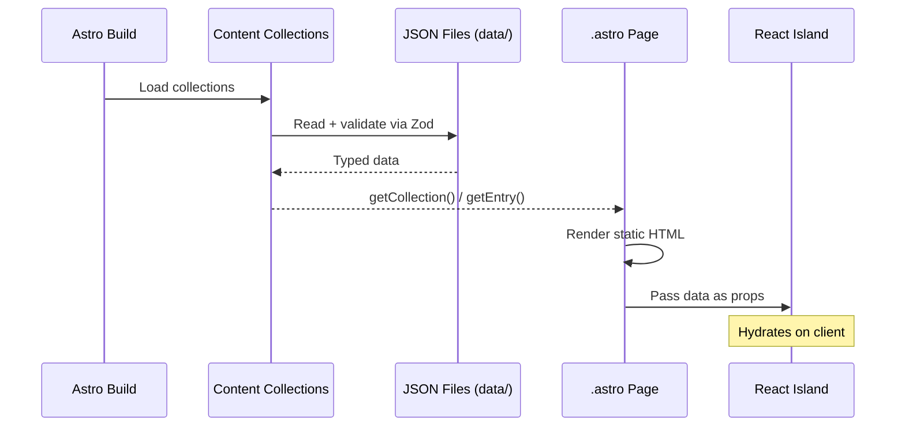

# Design Document: Astro Migration

## Overview

This design describes the migration of the Lingo Lotus language learning website from Gatsby 5.11 to Astro 5+ while preserving all existing functionality. The migration replaces the build framework (Gatsby → Astro), styling system (Chakra UI → Tailwind CSS v4), and component library (Chakra UI → shadcn/ui) in phases, maintaining React 18 for interactive features via Astro's islands architecture.

The site remains a statically-generated, S3+CloudFront-hosted application with zero server-side runtime. Content pages (flashcard listings, book indexes, stories) render as pure HTML with no JavaScript. Interactive features (study mode, speech synthesis) hydrate as React islands only on pages that need them.

### Key Design Decisions

1. **Astro Content Collections for data** — Replaces Gatsby's GraphQL + `gatsby-transformer-json` with `defineCollection()` using `glob()` loaders and Zod schemas. This eliminates GraphQL boilerplate while adding build-time type safety.

2. **Islands architecture** — Static `.astro` pages for content, React components with `client:load` for interactive study mode and speech synthesis. This minimizes JavaScript shipped to the browser.

3. **Phased styling migration** — Chakra UI v2 continues to work inside React islands during transition. Tailwind CSS handles static layouts first, then shadcn/ui replaces Chakra in interactive components.

4. **URL structure preserved via Astro dynamic routes** — `[collectionId].astro`, `[deckId].astro`, etc. with `getStaticPaths()` generating the same URL paths as the current Gatsby site.

5. **Same deployment model** — `astro build` produces `dist/` with static files, synced to S3 with the same cache headers and CloudFront invalidation.

## Architecture

### High-Level System Architecture



### Page Rendering Strategy



### Directory Structure

```
lingolotus.com/
├── astro.config.ts              # Astro configuration
├── tailwind.config.ts           # Tailwind CSS v4 config
├── tsconfig.json                # TypeScript (Astro preset)
├── package.json                 # pnpm scripts
├── pnpm-lock.yaml
├── data/                        # JSON data (unchanged)
│   ├── flash-cards/
│   │   ├── collections/*.json
│   │   └── decks/*.json
│   ├── books/
│   │   ├── *.json
│   │   └── stories/*.json
│   └── languages/*.json
├── content/
│   └── about.md
├── public/                      # Static assets (no processing)
│   ├── images/
│   ├── favicon.ico
│   ├── manifest.json
│   └── robots.txt
├── src/
│   ├── content/
│   │   └── config.ts           # Content collection schemas
│   ├── components/
│   │   ├── islands/            # React islands (client-hydrated)
│   │   │   ├── StudyMode.tsx
│   │   │   ├── SpeechButton.tsx
│   │   │   └── ThemeToggle.tsx
│   │   └── ui/                 # shadcn/ui components
│   │       ├── button.tsx
│   │       ├── card.tsx
│   │       └── breadcrumb.tsx
│   ├── layouts/
│   │   ├── BaseLayout.astro    # HTML shell, meta, theme script
│   │   └── PageLayout.astro    # Content page with nav + footer
│   ├── pages/
│   │   ├── index.astro
│   │   ├── about.astro
│   │   ├── 404.astro
│   │   ├── flash-cards/
│   │   │   ├── index.astro
│   │   │   └── [collectionId]/
│   │   │       ├── index.astro
│   │   │       └── decks/
│   │   │           └── [deckId]/
│   │   │               ├── index.astro
│   │   │               └── study.astro
│   │   └── reading/
│   │       ├── index.astro
│   │       └── [bookId]/
│   │           ├── index.astro
│   │           └── [storyId].astro
│   ├── styles/
│   │   └── global.css          # Tailwind directives + Thai fonts
│   ├── lib/
│   │   └── utils.ts            # cn() helper, path utilities
│   └── types/
│       └── index.ts            # Shared TypeScript types
├── cdk/                         # Infrastructure (unchanged)
└── scripts/
    └── deploy.sh               # Build + S3 sync + CF invalidation
```

## Components and Interfaces

### Content Collection Configuration (`src/content/config.ts`)

Defines Zod schemas and collection loaders for all JSON data:

```typescript
import { defineCollection, z } from "astro:content";
import { glob } from "astro/loaders";

const flashcardCollections = defineCollection({
  loader: glob({ pattern: "**/*.json", base: "data/flash-cards/collections" }),
  schema: z.object({
    collectionId: z.string(),
    name: z.string(),
    description: z.string(),
    sourceLanguage: z.string(),
    targetLanguage: z.string(),
    createdAt: z.string(),
    updatedAt: z.string(),
    category: z.string().optional(),
    difficulty: z.enum(["beginner", "intermediate", "advanced", "mixed"]).optional(),
    imageUrl: z.string().optional(),
    featured: z.boolean().optional(),
  }),
});

const flashcardDecks = defineCollection({
  loader: glob({ pattern: "**/*.json", base: "data/flash-cards/decks" }),
  schema: z.object({
    collectionId: z.string(),
    deckId: z.string(),
    name: z.string(),
    description: z.string(),
    sourceLanguage: z.string(),
    targetLanguage: z.string(),
    cards: z.array(z.object({
      frontContent: z.object({ type: z.literal("text"), text: z.string() }),
      backContent: z.object({ type: z.literal("text"), text: z.string() }),
      tags: z.array(z.string()),
      difficulty: z.string(),
      sourceLanguage: z.string(),
      targetLanguage: z.string(),
      phonetic: z.string().optional(),
      partOfSpeech: z.string().optional(),
      context: z.string().optional(),
      examples: z.array(z.object({
        original: z.string(),
        translation: z.string(),
        phonetic: z.string().optional(),
      })).optional(),
    })).min(1),
    createdAt: z.string(),
    updatedAt: z.string(),
    theme: z.string(),
    category: z.string().optional(),
    difficulty: z.enum(["beginner", "intermediate", "advanced", "mixed"]).optional(),
  }),
});

const books = defineCollection({
  loader: glob({ pattern: "*.json", base: "data/books" }),
  schema: z.object({
    bookId: z.string(),
    name: z.string(),
    description: z.string(),
    sourceLanguage: z.string(),
    createdAt: z.string(),
    updatedAt: z.string(),
    targetLanguage: z.string().optional(),
    category: z.string().optional(),
    difficulty: z.enum(["beginner", "intermediate", "advanced"]).optional(),
    imageUrl: z.string().optional(),
    featured: z.boolean().optional(),
  }),
});

const stories = defineCollection({
  loader: glob({ pattern: "**/*.json", base: "data/books/stories" }),
  schema: z.object({
    storyId: z.string(),
    bookId: z.string(),
    language: z.string(),
    title: z.object({ source: z.string(), target: z.string() }),
    sentences: z.array(z.object({
      source: z.string(),
      target: z.string(),
      phonetic: z.string(),
      breakdown: z.array(z.object({
        source: z.string(),
        target: z.string(),
        phonetic: z.string(),
        partOfSpeech: z.string().optional(),
      })).optional(),
    })).min(1),
    createdAt: z.string(),
    updatedAt: z.string(),
    difficulty: z.enum(["beginner", "intermediate", "advanced"]).optional(),
    summary: z.object({ source: z.string(), target: z.string() }).optional(),
  }),
});

const languages = defineCollection({
  loader: glob({ pattern: "**/*.json", base: "data/languages" }),
  schema: z.object({
    languageCode: z.string(),
    language: z.string(),
    english: z.string(),
    flag: z.string(),
  }),
});

export const collections = {
  "flashcard-collections": flashcardCollections,
  "flashcard-decks": flashcardDecks,
  books,
  stories,
  languages,
};
```

### Astro Configuration (`astro.config.ts`)

```typescript
import { defineConfig } from "astro/config";
import react from "@astrojs/react";
import tailwind from "@astrojs/tailwind";
import sitemap from "@astrojs/sitemap";

export default defineConfig({
  site: "https://lingolotus.com",
  output: "static",
  trailingSlash: "never",
  integrations: [
    react(),
    tailwind(),
    sitemap(),
  ],
});
```

### Layout Components

**BaseLayout.astro** — HTML shell with meta tags, theme initialization script, and global styles:

```astro
---
interface Props {
  title: string;
  description: string;
  ogType?: "website" | "article";
  canonicalPath: string;
  jsonLd?: Record<string, unknown>;
}
const { title, description, ogType = "website", canonicalPath, jsonLd } = Astro.props;
const canonicalUrl = `https://lingolotus.com${canonicalPath}`;
---
<html lang="en">
<head>
  <meta charset="utf-8" />
  <meta name="viewport" content="width=device-width, initial-scale=1" />
  <title>{title}</title>
  <meta name="description" content={description} />
  <link rel="canonical" href={canonicalUrl} />
  <meta property="og:title" content={title} />
  <meta property="og:description" content={description} />
  <meta property="og:url" content={canonicalUrl} />
  <meta property="og:type" content={ogType} />
  <meta property="og:site_name" content="Lingo Lotus" />
  {jsonLd && <script type="application/ld+json" set:html={JSON.stringify(jsonLd)} />}
  <!-- Theme initialization (no FOUC) -->
  <script is:inline>
    const theme = localStorage.getItem("theme") ??
      (matchMedia("(prefers-color-scheme: dark)").matches ? "dark" : "light");
    document.documentElement.classList.toggle("dark", theme === "dark");
  </script>
</head>
<body class="min-h-screen bg-white dark:bg-gray-950 text-gray-900 dark:text-gray-100">
  <slot />
</body>
</html>
```

### React Island Components

**StudyMode.tsx** — Interactive flashcard study experience (hydrates with `client:load`):

Interface:
```typescript
interface StudyModeProps {
  cards: Array<{
    frontContent: { type: string; text: string };
    backContent: { type: string; text: string };
    phonetic?: string;
    examples?: Array<{ original: string; translation: string; phonetic?: string }>;
    sourceLanguage: string;
    targetLanguage: string;
  }>;
  deckName: string;
  collectionId: string;
  deckId: string;
}
```

Responsibilities:
- Card flipping (click/tap to reveal back)
- Sequential navigation (next/previous with boundary disabling)
- Progress tracking (correct/incorrect/remaining counters)
- Language toggle (swap front display between source and target)
- Keyboard navigation (arrow keys, space to flip)

**SpeechButton.tsx** — Text-to-speech control (hydrates with `client:visible`):

Interface:
```typescript
interface SpeechButtonProps {
  text: string;
  languageCode: string;
}
```

Responsibilities:
- Invokes Web Speech API with language-appropriate voice
- Shows speaking/idle visual state
- Disables when API unavailable or no voice found

**ThemeToggle.tsx** — Dark/light mode switch (hydrates with `client:load`):

Interface:
```typescript
// No props — reads/writes localStorage and class on <html>
```

### Shared Utilities (`src/lib/utils.ts`)

```typescript
import { clsx, type ClassValue } from "clsx";
import { twMerge } from "tailwind-merge";

export function cn(...inputs: ClassValue[]) {
  return twMerge(clsx(inputs));
}
```

### Page Data Flow



## Data Models

### Content Collection Schemas

The existing JSON data files are loaded unchanged. Zod schemas provide build-time validation and TypeScript type inference.

#### Flashcard Collection

| Field | Type | Required | Description |
|-------|------|----------|-------------|
| collectionId | string | Yes | Unique identifier, used in URL path |
| name | string | Yes | Display name |
| description | string | Yes | Collection description |
| sourceLanguage | string | Yes | ISO language code (e.g., "th") |
| targetLanguage | string | Yes | ISO language code (e.g., "en") |
| createdAt | string (ISO 8601) | Yes | Creation timestamp |
| updatedAt | string (ISO 8601) | Yes | Last update timestamp |
| category | string | No | Content category |
| difficulty | enum | No | beginner, intermediate, advanced, mixed |
| imageUrl | string | No | Path to collection image |
| featured | boolean | No | Whether shown on homepage |

#### Flashcard Deck

| Field | Type | Required | Description |
|-------|------|----------|-------------|
| collectionId | string | Yes | Parent collection reference |
| deckId | string | Yes | Unique deck identifier, used in URL path |
| name | string | Yes | Display name |
| description | string | Yes | Deck description |
| sourceLanguage | string | Yes | ISO language code |
| targetLanguage | string | Yes | ISO language code |
| cards | Card[] (min 1) | Yes | Array of flashcard objects |
| createdAt | string (ISO 8601) | Yes | Creation timestamp |
| updatedAt | string (ISO 8601) | Yes | Last update timestamp |
| theme | string | Yes | Deck theme (greetings, food, etc.) |
| category | string | No | Content category |
| difficulty | enum | No | beginner, intermediate, advanced, mixed |

#### Card (nested in Deck)

| Field | Type | Required | Description |
|-------|------|----------|-------------|
| frontContent | { type: "text", text: string } | Yes | Card front |
| backContent | { type: "text", text: string } | Yes | Card back |
| tags | string[] | Yes | Categorization tags |
| difficulty | string | Yes | Card difficulty level |
| sourceLanguage | string | Yes | ISO language code |
| targetLanguage | string | Yes | ISO language code |
| phonetic | string | No | Pronunciation guide |
| partOfSpeech | string | No | Grammar category |
| context | string | No | Usage context |
| examples | Example[] | No | Usage examples |

#### Book

| Field | Type | Required | Description |
|-------|------|----------|-------------|
| bookId | string | Yes | Unique identifier, used in URL path |
| name | string | Yes | Display name |
| description | string | Yes | Book description |
| sourceLanguage | string | Yes | ISO language code |
| createdAt | string (ISO 8601) | Yes | Creation timestamp |
| updatedAt | string (ISO 8601) | Yes | Last update timestamp |
| targetLanguage | string | No | ISO language code |
| category | string | No | Content category |
| difficulty | enum | No | beginner, intermediate, advanced |
| imageUrl | string | No | Path to book cover image |
| featured | boolean | No | Whether featured |

#### Story

| Field | Type | Required | Description |
|-------|------|----------|-------------|
| storyId | string | Yes | Unique identifier, used in URL path |
| bookId | string | Yes | Parent book reference |
| language | string | Yes | Story language code |
| title | { source: string, target: string } | Yes | Bilingual title |
| sentences | Sentence[] (min 1) | Yes | Story content |
| createdAt | string (ISO 8601) | Yes | Creation timestamp |
| updatedAt | string (ISO 8601) | Yes | Last update timestamp |
| difficulty | enum | No | beginner, intermediate, advanced |
| summary | { source: string, target: string } | No | Bilingual summary |

#### Sentence (nested in Story)

| Field | Type | Required | Description |
|-------|------|----------|-------------|
| source | string | Yes | Original language text |
| target | string | Yes | Translation |
| phonetic | string | Yes | Pronunciation guide |
| breakdown | Breakdown[] | No | Word-by-word analysis |

#### Language

| Field | Type | Required | Description |
|-------|------|----------|-------------|
| languageCode | string | Yes | ISO language code |
| language | string | Yes | Native name |
| english | string | Yes | English name |
| flag | string | Yes | Flag emoji |

### URL Route Mapping

| URL Pattern | Data Source | Page Type |
|-------------|-------------|-----------|
| `/` | flashcard-collections (featured) | Static |
| `/flash-cards` | flashcard-collections (all) | Static |
| `/flash-cards/{collectionId}` | flashcard-decks (filtered by collectionId) | Static |
| `/flash-cards/{collectionId}/decks/{deckId}` | flashcard-decks (single) | Static |
| `/flash-cards/{collectionId}/decks/{deckId}/study` | flashcard-decks (single, cards) | Island |
| `/reading` | books (all) | Static |
| `/reading/{bookId}` | stories (filtered by bookId) | Static |
| `/reading/{bookId}/{storyId}` | stories (single) | Static |
| `/about` | content/about.md | Static |
| `/404.html` | — | Static |

### Build-Time Referential Integrity

The build process validates cross-collection references:
- Every deck's `collectionId` must match an existing collection's `collectionId`
- Every story's `bookId` must match an existing book's `bookId`

If a reference is broken, the build fails with an error identifying the orphaned entry.


## Correctness Properties

*A property is a characteristic or behavior that should hold true across all valid executions of a system — essentially, a formal statement about what the system should do. Properties serve as the bridge between human-readable specifications and machine-verifiable correctness guarantees.*

### Property 1: Schema Validation Round-Trip

*For any* valid data object conforming to a content collection schema (flashcard collection, deck, book, story, or language), serializing it to JSON and parsing it through the Zod schema SHALL produce an equivalent object with all fields preserved. *For any* object missing a required field or containing an invalid type, the schema SHALL reject it with a validation error.

**Validates: Requirements 2.1, 2.2, 2.3, 2.4, 2.5**

### Property 2: Path Generation Correctness

*For any* valid content identifier string(s) (collectionId, deckId, bookId, storyId), the URL path generation functions SHALL produce a string that starts with `/`, contains each identifier as a path segment in the correct position, and matches the pattern defined in the URL Structure (e.g., `/flash-cards/{collectionId}/decks/{deckId}` for deck paths).

**Validates: Requirements 3.3, 3.4, 3.5, 3.7, 3.8**

### Property 3: Referential Integrity — Collection References

*For any* set of flashcard collections and flashcard decks, if a deck's `collectionId` does not match any collection's `collectionId` in the set, the referential integrity validator SHALL return an error identifying the orphaned deck. If all deck `collectionId` values match existing collections, the validator SHALL return success.

**Validates: Requirements 3.12**

### Property 4: Navigation Boundary States

*For any* deck with N cards (N ≥ 1) and current card index I (0 ≤ I < N), the previous navigation control SHALL be disabled if and only if I = 0, and the next navigation control SHALL be disabled if and only if I = N - 1.

**Validates: Requirements 5.3**

### Property 5: Progress Calculation Invariant

*For any* deck with N total cards and counts of correct (C) and incorrect (I) responses where C + I ≤ N, the remaining count SHALL equal N - C - I, and the sum correct + incorrect + remaining SHALL always equal N.

**Validates: Requirements 5.4**

### Property 6: Language Toggle Swap

*For any* flashcard with source text S and target text T, when the language toggle is set to "source", the card front SHALL display S. When toggled to "target", the card front SHALL display T. Toggling twice SHALL return to the original display.

**Validates: Requirements 5.7**

### Property 7: Breadcrumb Structure from URL Path

*For any* valid URL path with K segments (K ≥ 1), the breadcrumb component SHALL render a `<nav aria-label="breadcrumb">` containing K + 1 items (home + each segment), where the last item has `aria-current="page"` and all other items are links.

**Validates: Requirements 7.4**

### Property 8: SEO Metadata Completeness

*For any* page with a name string (≤ 60 characters) and description string (≤ 160 characters) and URL path, the SEO metadata generator SHALL produce a title tag matching the name, a meta description matching the description, an `og:url` matching `https://lingolotus.com{path}`, a canonical link matching the same URL, and for content detail pages, a JSON-LD block of type `WebPage` containing the name, description, and URL.

**Validates: Requirements 9.1, 9.2, 9.3, 9.7**

### Property 9: Image Reference Validation

*For any* content collection entry with an `imageUrl` field, if the referenced file does not exist at the resolved path in `public/`, the image validator SHALL return an error identifying the entry and the missing file path. If the file exists, the validator SHALL return success.

**Validates: Requirements 11.4**

## Error Handling

### Build-Time Errors

| Error Condition | Behavior | User Feedback |
|----------------|----------|---------------|
| Zod schema validation failure | Build fails immediately | File path, field name, expected vs actual type |
| Orphaned collection reference (deck → missing collection) | Build fails | Deck file path, invalid collectionId value |
| Orphaned book reference (story → missing book) | Build fails | Story file path, invalid bookId value |
| Missing imageUrl file | Build fails | Entry identifier, expected file path |
| TypeScript type error | Build fails | File, line, error message |
| Missing required page data | Build fails | Page template, missing field |

### Runtime Errors (Client-Side)

| Error Condition | Behavior | Fallback |
|----------------|----------|----------|
| Web Speech API unavailable | Speech button disabled | Visual indicator (grayed out button with tooltip) |
| No voice found for language | Speech button disabled | Same as above |
| Speech synthesis error during playback | Stop speaking state | Reset speaking indicator to idle |
| localStorage unavailable (private browsing) | Theme defaults to system preference | No persistence, use OS preference each visit |
| React island hydration failure | Island shows static content | ErrorBoundary catches and displays fallback UI |

### Progressive Migration Errors

| Error Condition | Behavior |
|----------------|----------|
| Chakra + Tailwind CSS collision | Tailwind base reset scoped to exclude Chakra islands |
| Dual hydration conflict | Each island is independent; no shared state between Chakra and shadcn islands |
| Missing Emotion peer dependency during Phase 1 | Explicitly include @emotion/react and @emotion/styled in dependencies until Chakra removed |

## Testing Strategy

### Unit Tests (Example-Based)

Focus on specific scenarios and edge cases:

- **Component rendering**: StudyMode renders first card, SpeechButton renders in both states
- **Edge cases**: Empty collections render empty-state message, single-card deck disables both nav buttons
- **Accessibility**: ARIA attributes present on cards, buttons, breadcrumbs
- **Dark mode**: Theme toggle updates localStorage and class
- **SEO fallbacks**: Missing description uses default

### Property-Based Tests

**Library**: [fast-check](https://github.com/dubzzz/fast-check) (TypeScript PBT library)

**Configuration**: Minimum 100 iterations per property test.

Each property test references its design document property:

| Property | Test Target | Generator Strategy |
|----------|-------------|-------------------|
| Property 1: Schema Round-Trip | Zod schemas in `src/content/config.ts` | Generate random objects with valid types/required fields; also generate invalid objects with missing/wrong-type fields |
| Property 2: Path Generation | `src/lib/utils.ts` path functions | Generate random alphanumeric strings for IDs |
| Property 3: Referential Integrity | Build-time validation function | Generate random collection/deck sets with varying overlap |
| Property 4: Navigation Boundaries | StudyMode navigation logic | Generate random deck sizes (1-100) and index positions |
| Property 5: Progress Calculation | Progress display logic | Generate random N, C, I where C+I ≤ N |
| Property 6: Language Toggle | StudyMode toggle logic | Generate random source/target text pairs |
| Property 7: Breadcrumb Structure | Breadcrumb component | Generate random path segment arrays (1-5 segments) |
| Property 8: SEO Metadata | SEO helper functions | Generate random name (≤60 chars), description (≤160 chars), paths |
| Property 9: Image Validation | Image reference validator | Generate random imageUrl paths, some existing some not |

**Tag format**: `Feature: astro-migration, Property {N}: {title}`

### Integration Tests

Verify end-to-end build behavior:

- Build completes with exit code 0
- All expected HTML files exist in `dist/`
- HTML pages contain expected content without `<script>` on static pages
- Study page includes hydration script
- Sitemap contains all URLs
- Deploy script syncs with correct cache headers

### Visual Regression Tests

- Screenshot comparison at 320px, 768px, 1280px for key pages
- Dark mode rendering verification
- Thai font rendering validation

### Migration Phase Verification

Each phase has a gate test:
1. **Platform phase**: Build succeeds with Chakra in React islands
2. **Styling phase**: Build succeeds with both Tailwind and Chakra
3. **Component phase**: Build succeeds with shadcn and Chakra in separate islands
4. **Completion**: No Gatsby/Chakra imports remain, all URLs render
